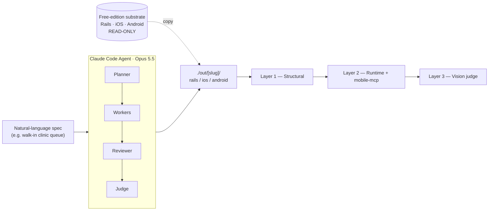

# NativeAppTemplate Agent

A Claude Code agent that turns a natural-language spec — something as informal as `"a walk-in queue for a barbershop"` — into a working three-platform implementation:

- **Rails 8.1 API**
- **native SwiftUI iOS**
- **native Jetpack Compose Android**

Coherent across all three, in under an hour.

[](https://www.npmjs.com/package/nativeapptemplate-agent)
[](https://github.com/nativeapptemplate/nativeapptemplate-agent/actions/workflows/ci.yml)
[](./LICENSE)
[](https://nodejs.org/)

```bash
npx nativeapptemplate-agent "a walk-in clinic queue for small veterinary practices" --project-name="VetClinic"
```

> **Status: 0.4.4 stable.** First built during [Built with Opus 4.7: a Claude Code Hackathon](https://cerebralvalley.ai/e/built-with-4-7-hackathon) (April 21–27, 2026); shipped to npm post-hackathon. Verified end-to-end on the three demo specs below from a fresh `/tmp/` cwd — the full 3-spec × 2-edition × 2-platform matrix is green at `NATIVEAPPTEMPLATE_VISUAL=2` (see the [matrix](#demo)). Stage 2 (scripted-CRUD walk-through via `mobile-mcp` against a live Rails server) and paid-edition parity validation landed post-launch. Active development continues — see the [roadmap](./ROADMAP.md) for what's next.

---

## Quick Start

### Option 1: Claude Code plugin (recommended)

Install the plugin once, then drive the agent with two slash commands — `/nativeapptemplate-agent:generate-app` (generate → validate → explain) and `/nativeapptemplate-agent:walk-app` (launch the app on a simulator/emulator and walk its UI via `mobile-mcp`, screenshots inline).

```bash
/plugin marketplace add nativeapptemplate/nativeapptemplate-agent
/plugin install nativeapptemplate-agent@nativeapptemplate
```

Then in Claude Code:

```
/nativeapptemplate-agent:generate-app a walk-in clinic queue for small veterinary practices. project name is VetClinic.
```

Or load it locally without the marketplace: `claude --plugin-dir ./plugin`. See [`plugin/README.md`](./plugin/README.md) for the reference card, and the [A-to-Z plugin guide](./docs/PLUGIN-GUIDE.md) for a full walkthrough.

### Option 2: Standalone CLI

No editor required — runs anywhere Node 22+ is installed.

```bash
npx nativeapptemplate-agent "a walk-in clinic queue for small veterinary practices" --project-name="VetClinic"
```

Generated output appears under `./out/<slug>/`. See [Usage](#usage) for rename overrides and report flags.

> **Pass a project name.** `--project-name` (or "project name is …" in the plugin) pins the Pascal project name, output slug (`out/vet-clinic/`), Xcode scheme, and display name across all three platforms. Omit it and the planner picks one — fine for one-off exploration, but it'll differ across re-runs.

> **Pass a domain if the app will ship.** `--domain=vetclinic.app` (or "domain is …" in the plugin) sets the app's web domain and, from its reverse, the iOS bundle ID (`app.vetclinic.VetClinic.ios`) and the Android applicationId / package (`app.vetclinic.vetclinic`). Neither ID can change after the first store release. Omit it and you get `<project name>.com` (`vetclinic.com`, `com.vetclinic.…`).

> **Set your own Apple team.** The generated iOS project has no `DEVELOPMENT_TEAM` (the template's is cleared), so the first build for a device asks for one: choose your team in Xcode under the target's Signing & Capabilities. Simulator builds need none. The paid template's invitation link (Associated Domains, `applinks:api.<domain>`) also needs the generated API to serve your `<Team ID>.<bundle ID>`: set `app_links` in its `config/settings.yml` (or `APP_LINKS_IOS_APP_IDS`), as its README's "Invitation links" section says.

> Using Cursor, Cline, Goose, or another MCP-capable editor? The generator also ships as an MCP server: `npx -y -p nativeapptemplate-agent nativeapptemplate-agent-mcp` exposes a `generate_app` tool you can wire into your editor's MCP config.

---

## Why this exists

Most "AI builds an app" tools stop at a single web frontend. The real pain for anyone shipping a mobile product is that the *same* domain has to be implemented three times — multi-tenant Rails API, native iOS, native Android — each with its own idioms, and keeping them consistent is where weeks disappear.

Classic mobile boilerplates sell "save 12–16 weeks of setup." AI coding tools have compressed that value to 2–3 weeks of AI-assisted work. The durable problem that remains — even with AI — is **cross-platform coherence**: keeping a Rails API, a native iOS client, and a native Android client all consistent under iteration, with no contract drift, no forgotten rename, no divergent localized copy.

This agent is an answer to that: turn a boilerplate into a generator that produces coherent three-platform implementations on demand, with structural and semantic validation built in.

> 📝 **Background:** [*One sentence becomes a native iOS app, a native Android app, and a Rails API*](https://medium.com/@dadachix/one-sentence-becomes-a-native-ios-app-a-native-android-app-and-a-rails-api-0000aaf9010c) — the long-form version of this argument: why cross-platform coherence, not code volume, is the problem AI didn't make easier.

## What it does

Point the agent at a natural-language spec:

```
a walk-in clinic queue for small veterinary practices
```

It will:

1. **Parse the spec** into a structured domain (entities, fields, relationships, state machines).
2. **Copy the free-edition substrate** (three MIT-licensed repos covering Rails + iOS + Android) into `./out/<spec-slug>/{rails,ios,android}/`.
3. **Rename the skeleton** — `Shop → Clinic`, `Shopkeeper → Vet`, etc. — consistently across Ruby migrations, Swift models, Kotlin data classes, policies, tests, and localized copy. Links to the template's own repos (`github.com/nativeapptemplate/...`) and the name `nativeapptemplate-agent` are left as they are, so the generated docs keep working links; the template's domain (`nativeapptemplate.com`) becomes your app's (`<project name>.com`, or the one you pass with `--domain`).
4. **Adapt or replace the domain module** — keep `ItemTag` for walk-in queue variants; strip and insert a new resource for non-queue SaaS. Then run each app's autocorrecting formatter (`bin/rubocop -a`, `./gradlew spotlessApply`, `swiftformat <Product>`), since the rename shifts alignment and import order; whatever they can't fix is listed in the validation report.
5. **Drive the build green** — every platform must pass before the agent exits. By default this is a fast gate: Rails routes load (`bin/rails routes`) and the iOS/Android projects resolve (`xcodebuild -list`, `./gradlew --version`). With `NATIVEAPPTEMPLATE_VISUAL=1`+ it escalates to full builds — Rails boots (`bin/rails db:prepare` + `bin/rails runner`), iOS builds (`xcodebuild build`), Android builds (`./gradlew assembleDebug`). The generated apps' **test suites don't run by default**; `NATIVEAPPTEMPLATE_TESTS=1` adds `bin/rails test`, `xcodebuild test` and `./gradlew testDebugUnitTest`.
6. **Validate the output** across three layers (structural, runtime, semantic) and write a self-contained HTML + JSON [validation report](#validation-report). Details in [`docs/SPEC.md`](./docs/SPEC.md) section 6.

## Demo

**Quick look (40s)** — what the agent does, the three distribution surfaces, and a live walk of the generated app: **▸ [Watch on YouTube](https://youtu.be/fsjfskPWecQ)**

**Full end-to-end run (90s)** — spec → renamed Rails API + iOS app + Android app, all three platforms validated:

https://github.com/user-attachments/assets/bd1ed091-93d8-45d7-b502-c21720218484

Also on [YouTube](https://youtu.be/z08ueZX-02I) for full-screen viewing.

Three demo specs, both adapt and replace paths, all four validation layers green end-to-end:

| Spec | Domain entity (post-rename) | Path | Result |
|---|---|---|---|
| `"a walk-in clinic queue for small veterinary practices"` | `ItemTag → Patient`, `Shop → Clinic`, `Shopkeeper → Vet` | adapt | Layer 1 3/3 · Layer 2 3/3 · Layer 3 2/2 · Reviewer PASS |
| `"a restaurant waitlist for casual dining"` | `Shop → Restaurant`, `Shopkeeper → Host` | adapt | Layer 1 3/3 · Layer 2 3/3 · Layer 3 2/2 · Reviewer PASS |
| `"a personal task tracker with due dates"` | `ItemTag → Todo` (replaces queue entry entirely) | replace | Layer 1 3/3 · Layer 2 3/3 · Layer 3 2/2 · Reviewer PASS |

Layer 2 ran in build mode — real `xcodebuild build` and `./gradlew assembleDebug`, full app builds installed on iPhone 17 Pro simulator and Android emulator. Layer 3 captured the home-screen via `xcrun simctl io booted screenshot` / `adb exec-out screencap` and judged against the rubric using Opus 5.5 vision (median of 3 samples per criterion). With `NATIVEAPPTEMPLATE_VISUAL=2`, Layer 2 additionally drives a scripted-CRUD walk-through via `mobile-mcp` against a live Rails server — Welcome → Sign Up → email-confirm via `bin/rails runner` → Sign In → drill into the auto-seeded sample — and Layer 3 then judges the post-walk screenshot against a domain-content rubric.

The agent works on either the **free (MIT) edition** or the **paid edition** without code changes — the same pipeline handles both substrates; multi-tenant features (org switching, invitations, role permissions) survive the rename pipeline when targeting paid. The agent tests paid first because free is a strict subset of paid; running paid first catches regressions that wouldn't surface against free alone.

### Validation matrix — 12/12 green at `VISUAL=2`

All three specs pass a full end-to-end `NATIVEAPPTEMPLATE_VISUAL=2` run (build → rename → boot → scripted-CRUD walk → vision judge) on **both editions and both platforms** — 12 cells (3 specs × 2 editions × 2 platforms), each **Layer 1 3/3 · Layer 2 3/3 · Layer 3 2/2 · reviewer PASS** on a real iPhone 17 Pro simulator + Android emulator:

| Spec | Free (iOS · Android) | Paid (iOS · Android) |
|---|---|---|
| Walk-in queue | ✅ · ✅ | ✅ · ✅ |
| Restaurant / sushi waitlist | ✅ · ✅ | ✅ · ✅ |
| Personal task tracker | ✅ · ✅ | ✅ · ✅ |

After the queue cell's Stage-2 hardening landed, sushi and the task tracker passed first-try on both editions with no further changes — the scripted scenario is genuinely spec- and edition-agnostic (the task tracker is a non-queue spec running the same walk).

Both screenshots are real captures from the booted iOS Simulator and Android emulator post-`./gradlew assembleDebug` / `xcodebuild build`, after the agent installed and launched the generated app.

## Runtime

End-to-end wall-clock per run, measured from `report.json`'s `meta.durationMs` on a 2021 M1 Max with both simulators pre-booted:

| `--visual` / `NATIVEAPPTEMPLATE_VISUAL` | What runs | Observed time | Approx cost (Opus 5.5, 2026-10-15) |
|---|---|---|---|
| `0` (default) | Layer 1 (ripgrep) + Layer 2 *fast* (Rails boot probe, iOS/Android type-check) + reviewer | ~2–3 min | ~$0.02 (planner only, measured) |
| `1` | + full `xcodebuild build` + `./gradlew assembleDebug` + home-screen capture + Stage 1 vision judge | ~2.5 min (barbershop-queue · 2026-05-24) | ~$0.13 (derived) |
| `2` | + Rails server boot + scripted-CRUD walk via `mobile-mcp` + Stage 2 vision judge | ~7–8 min (sentova / sushi / task-tracker · 2026-05-23; orange-baton 7m 12s · 2026-10-17) | ~$0.22 (orange-baton, measured 2026-10-17) |

Cold builds, first-run cocoapods/gradle dependency resolution, or unbooted simulators add a one-time minute or two. `--tests` adds a few minutes and no API cost: the three suites run in parallel, so the same orange-baton VISUAL=2 run took 9m 52s with them (2026-10-18), about 2.5 min more; a 0.4.4 re-run from the published package with `--domain=orangebaton.com` and `--rename-ja` took 10m 03s on the paid templates (Rails 38 s, Android 67 s and iOS 115 s of tests) and 13m 47s on the free ones, where the iOS suite alone took 275 s (2026-10-27). The self-repair loop (opt-in, hard-capped at 5 iterations) can extend a failing run substantially — budget for it if you set `NATIVEAPPTEMPLATE_REPAIR=on`.

**Cost.** The agent makes real `claude-opus-5-5` API calls ($4 / $20 per million input / output tokens; 5-minute cache writes $5, cache reads $0.40; rates in [`src/models.ts`](./src/models.ts)). How the numbers above were made, on 2026-10-15:

- **Measured, per call:** the planner ("a walk-in queue for a barbershop") used 2,722 in / 446 out = **$0.020**. The vision judge caches the screenshot: its first call writes the cache (~150 in / ~110 out / ~4,400 cache-write tokens = **~$0.025**), then the remaining samples run in parallel and read it (~160 in / ~90–260 out / ~4,400 cache-read tokens = **~$0.006** each).
- **Measured, per platform:** a judge pass is 2 criteria × 3 samples = 6 calls: **$0.054** for Stage 1 (iOS home screen). Stage 2 sends the same shape of request on a list screen; before the cache warm-up it measured the same as Stage 1 ($0.15 each), so it is taken as ~$0.054 too.
- **Derived, per run:** VISUAL=1 = planner + Stage 1 on iOS and Android ≈ $0.13; VISUAL=2 adds Stage 2 on both ≈ $0.24. A judge retry after a transient render failure adds ~$0.05 per retried platform.
- **Measured, per run (2026-10-17):** a passing paid-edition VISUAL=2 run of the Orange Baton spec (see [Validation report](#validation-report)) cost **$0.223** — planner 2,761 in / 874 out = $0.029, plus 24 judge calls (Stage 1 + Stage 2 on iOS and Android) = 3,456 in / 2,976 out / 17,320 cache-write / 86,600 cache-read = $0.195. That's in line with the derived ~$0.24.
- **Checked against billing (2026-10-18):** three Orange Baton runs, as `tmp/trace/` logged them, summed to 17,835 in / 10,235 out / 47,584 cache-write / 237,920 cache-read tokens, ≈ $0.61 — the Claude Console's usage export for that key and day showed exactly the same token counts. Another VISUAL=2 run that day came to the same 24 judge calls, $0.2197 in all.
- **Reported per run (0.4.4, 2026-10-27):** a passing VISUAL=2 + `--tests` run of the same spec from the published package, with `--domain=orangebaton.com` and `--rename-ja Shop=案件 --rename-ja ItemTag=バトン`, recorded **$0.2181** in its own `report.json` — planner 2,762 in / 1,014 out = $0.0313, plus 24 judge calls = 3,456 in / 2,584 out / 17,320 cache-write / 86,600 cache-read = $0.1867. Same input and cache token counts as the trace-based measurement above; only the output tokens differ (a 0.4.2 run on 2026-10-18 recorded $0.2163 the same way).
- **Self-repair** (`NATIVEAPPTEMPLATE_REPAIR`): a toy fix converged in 3 turns for ~$0.10 (measured). A real Compose/Hilt build fix can take many more turns (up to 40); estimate ~$0.10–$1 per attempt, at most 5 attempts per run. Re-validation after a repair does not re-run the judge.

**Check your own spend:** every run reports its own estimate. The CLI's closing summary prints it after the verdict:

```
overall: PASS
cost: ≈ $0.2181 (25 API calls: planner $0.0313, judge $0.1867)
```

`report.json` has the per-agent breakdown under `cost` (calls, input / output / cache-write / cache-read tokens, USD; repair is the Agent SDK's own `total_cost_usd`), the HTML report shows it as an "API cost (estimate)" table, and the MCP tool returns it with the report. It is priced at the list rates above; for billed amounts, see usage per API key in the Claude Console, and set a workspace spend cap (see [Security](#security)) as a backstop — the agent exits non-zero on validation failure, but doesn't gate on spend itself. To total several runs, `npm --prefix <path-to-this-repo> run cost` (or `bash <path-to-this-repo>/scripts/cost.sh [trace_dir]`) adds up the per-call lines in `tmp/trace/` of the directory you ran the agent from; those logs append across runs, so clear `tmp/trace/` first to cost a single one.

## Architecture



## Substrate

The agent operates on the free, MIT-licensed edition of NativeAppTemplate — three public repos:

| Repo | Stack | LOC |
|---|---|---|
| [`nativeapptemplateapi`](https://github.com/nativeapptemplate/nativeapptemplateapi) | Rails 8.1, PostgreSQL, `devise_token_auth`, `pundit`, `acts_as_tenant` | 7,687 (Ruby) |
| [`NativeAppTemplate-Free-iOS`](https://github.com/nativeapptemplate/NativeAppTemplate-Free-iOS) | 100% SwiftUI, `@Observable`, MVVM, Liquid Glass design, iOS 26.2+ | 15,311 (Swift) |
| [`NativeAppTemplate-Free-Android`](https://github.com/nativeapptemplate/NativeAppTemplate-Free-Android) | 100% Kotlin, 100% Jetpack Compose, Hilt, Retrofit2, API 26+ | 19,521 (Kotlin) |

Combined ~42.5k LOC. Extracted from [MyTurnTag Creator](https://myturntag.com), a walk-in queue-management SaaS live on both app stores since 2024.

### Subscriptions in the paid templates

The paid iOS and Android templates include optional [RevenueCat](https://www.revenuecat.com) subscriptions. Generated apps keep them, **switched off**: billing stays off until you set your own app's RevenueCat key, so a generated app behaves as it would without billing (every feature open, no paywall). The agent never carries a key over:

- **iOS:** the key is `REVENUECAT_API_KEY` in `RevenueCat.xcconfig` (committed empty). The template's gitignored `RevenueCat.local.xcconfig`, which may hold the template developer's own key, is not copied into the generated app; `API.local.xcconfig` still is, so Debug builds keep pointing at your local Rails. Generated iOS apps depend on [`purchases-ios`](https://github.com/RevenueCat/purchases-ios) through Swift Package Manager, so the **first build needs network access** to resolve it.
- **Android:** the key is the Gradle property `<PRODUCT>_REVENUECAT_GOOGLE_API_KEY` (e.g. `CLINICQUEUE_REVENUECAT_GOOGLE_API_KEY`), renamed with the app. The env bridge mirrors only the API settings (`<PRODUCT>_API_*`), never `NATIVEAPPTEMPLATE_REVENUECAT_GOOGLE_API_KEY`.

To turn billing on, follow the template's subscription docs (`docs/subscription.md` on iOS, `docs/subscriptions.md` on Android) with your own RevenueCat app. The paywall copy that names the primary resource ("Run all your shops from one account", 店舗) is renamed with it.

### Error monitoring (Sentry) in the templates

The paid iOS and Android templates and the Rails API include optional [Sentry](https://sentry.io) error monitoring, **off** until you set your own DSN. Generated apps keep it off and never carry the template developer's settings over:

- **iOS:** `SENTRY_DSN`, `SENTRY_ORG` and `SENTRY_PROJECT` live in `Sentry.xcconfig` (committed empty), included by `Project.xcconfig`, the project's base configuration for Debug and Release. Both files are copied and stay wired (the renamed `.pbxproj` keeps `Project.xcconfig` as the base configuration). The gitignored `Sentry.local.xcconfig` (the developer's own DSN) is not copied. The "Upload dSYMs to Sentry" build phase does nothing while the DSN, org or project is empty. The project depends on [`sentry-cocoa`](https://github.com/getsentry/sentry-cocoa) through Swift Package Manager, so the first build needs network access.
- **Android:** the DSN and the R8 mapping upload read the Gradle properties `<PRODUCT>_SENTRY_DSN`, `<PRODUCT>_SENTRY_ORG`, `<PRODUCT>_SENTRY_PROJECT` (e.g. `FADEQUEUE_SENTRY_DSN`), renamed with the app; without them `BuildConfig.SENTRY_DSN` is empty and no mapping is uploaded. The env bridge never mirrors `NATIVEAPPTEMPLATE_SENTRY_*`.
- **Rails API:** `SENTRY_DSN` (unset in development and test); in production it comes from the Kamal secret `<SERVICE>_SENTRY_DSN` (e.g. `FADE_QUEUE_API_SENTRY_DSN` for the service `fade_queue_api`). The initializer's `NativeapptemplateSentry` module is renamed with the app (`FadeQueueSentry`).
- sentry-cli's auth token files (`.sentryclirc`, `sentry.properties`) are never copied from any substrate.

To turn it on, follow the template's README section "Error monitoring (Sentry)" with your own Sentry project.

### Push notifications (Firebase) in the paid Android template

The paid Android template sends push notifications through Firebase Cloud Messaging, configured by `app/google-services.json`. The template commits that file with **placeholder** values (the `com.google.gms.google-services` Gradle plugin fails the build without it) and its developer keeps their own Firebase project's file in the working tree under `git update-index --skip-worktree`. The agent never carries that file over: the generated app gets the file as the template commits it, so it builds, but FCM can't issue it a token and no device is registered with the API until you replace `android/app/google-services.json` with the one from your own Firebase project (register the generated app's package name there). A substrate that isn't a git checkout gets no `google-services.json` at all, and the Android build fails with "File google-services.json is missing" until you add yours. The free Android template has no Firebase.

## Usage

```bash
# Standalone CLI
npx nativeapptemplate-agent "a walk-in clinic queue for small veterinary practices"

# Stretch specs the agent is also designed to handle
npx nativeapptemplate-agent "a restaurant waitlist for casual dining"
npx nativeapptemplate-agent "a personal task tracker with due dates"

# Name the project explicitly (sets display name + output slug, independent of the
# domain rename). The plugin/MCP path accepts the same intent in plain language —
# "…detection. project name is Sentova." — mapped to the projectName argument.
npx nativeapptemplate-agent "a two-device home monitor for household pest detection" --project-name="Sentova"
# → out/sentova/ · Sentova.xcodeproj · "Sentova API"; adapts ItemTag (e.g. Shop→Household, ItemTag→Sighting)

# Choose the app's domain ("…domain is sentova.app." in the plugin/MCP path, mapped
# to the domain argument). Without it: sentova.com, com.sentova.Sentova.ios, com.sentova.sentova.
npx nativeapptemplate-agent "a two-device home monitor for household pest detection" --project-name="Sentova" --domain=sentova.app
# → api.sentova.app · support@sentova.app · iOS app.sentova.Sentova.ios · Android app.sentova.sentova

# Generated output appears under ./out/<slug>/
tree ./out/clinic-queue/
# ├── rails/                   ← Rails 8.1 API, git-initialized, buildable
# ├── ios/                     ← SwiftUI iOS project, buildable
# ├── android/                 ← Jetpack Compose Android project, buildable
# ├── report.json              ← machine-readable validation result
# └── validation-report.html   ← self-contained visual report (open in a browser)
```

The same generator also ships as an MCP server — `npx -y -p nativeapptemplate-agent nativeapptemplate-agent-mcp` exposes a `generate_app` tool, so any MCP-capable assistant (Claude Code, Cursor, Cline, Goose) can invoke it without leaving the editor. And a **Claude Code plugin** ships in [`plugin/`](./plugin/) with two skills: `/nativeapptemplate-agent:generate-app` (generate → validate → explain) and `/nativeapptemplate-agent:walk-app` (launch the app on a simulator/emulator and walk its UI via `mobile-mcp`, screenshots inline). Install it via the bundled marketplace:

```bash
/plugin marketplace add nativeapptemplate/nativeapptemplate-agent
/plugin install nativeapptemplate-agent@nativeapptemplate
```

…or load it locally with `claude --plugin-dir ./plugin`. See [`plugin/README.md`](./plugin/README.md) for the reference card, or the **[A-to-Z plugin guide](./docs/PLUGIN-GUIDE.md)** for a full follow-along walkthrough.

## Requirements

- [Node.js](https://nodejs.org) 22+
- [Claude Agent SDK](https://github.com/anthropics/claude-agent-sdk-typescript) v0.3.286 or later and `@anthropic-ai/sdk` v0.131.0 or later (needed for Opus 5.5; both are installed as dependencies)
- An [Anthropic API key](https://console.anthropic.com/settings/keys) with access to `claude-opus-5-5`, exported as `ANTHROPIC_API_KEY`:
  ```bash
  export ANTHROPIC_API_KEY="sk-ant-..."
  ```
  The Anthropic SDK reads this env var automatically; no other config is required. See [Security](#security) below for storage recommendations.
- Local checkouts of the three substrate repos, referenced via environment variables:
  ```bash
  export NATIVEAPPTEMPLATE_API="/path/to/nativeapptemplateapi"
  export NATIVEAPPTEMPLATE_IOS="/path/to/NativeAppTemplate-Free-iOS"
  export NATIVEAPPTEMPLATE_ANDROID="/path/to/NativeAppTemplate-Free-Android"
  ```
  A starter [`/.env.example`](./.env.example) lists all the variables in one place.
- For runtime validation (Layer 2 onwards): Xcode 26.3+ with iOS 26.2+ simulator, Android SDK with API 26+ emulator. For the Stage 2 walk (`--visual=2`), boot an **iOS 26.x** simulator, not iOS 27: on iOS 27 the Keychain's "Save Password?" sheet after sign-in leaves nothing but the status bar in the accessibility snapshot, so the walk cannot dismiss it (seen with mobile-mcp 0.0.54 and 1.0.14 on iOS 27.0, 2026-10-27). The agent installs and walks the app on whichever simulator is booted, so boot exactly one.
- For UI automation: [`mobile-next/mobile-mcp`](https://github.com/mobile-next/mobile-mcp) (installed automatically as a Claude Code MCP server)

### Optional flags

- `NATIVEAPPTEMPLATE_VISUAL=1` (or `--visual=1` for one run) — opts the run into Stage 1 visual judging (Layer 3). When set, Layer 2 runs in **build mode** instead of fast mode (full `xcodebuild build` + `./gradlew assembleDebug`), then for each platform the agent installs the app on the booted sim/emulator, captures the home screen, and judges it with Opus 5.5 vision against `DEFAULT_STAGE1_RUBRIC`. Adds 60-180s per platform depending on cold-build time. Requires a sim/emulator booted for each platform you want judged. Off by default — `npm run dev` keeps the existing fast path.
- `NATIVEAPPTEMPLATE_VISUAL=2` (or `--visual=2`) — implies `=1` and additionally runs **Stage 2**: the agent boots the generated Rails app under `mise exec -- bin/dev` (after `bundle install` + `bin/rails db:prepare` + `bin/rails db:seed_fu`), waits for it to listen, then drives the iOS sim and Android emulator through the parameterized queue scenario (Sign Up → email-confirm via `bin/rails runner` → Sign In → drill into auto-seeded sample). Layer 3 then judges the last captured screenshot against `DEFAULT_STAGE2_RUBRIC` (domain content + no substrate-token leak). Adds 2–4 minutes per platform on top of `=1`. Requires both sims/emulators booted and the substrate's `mise` toolchain installed for `bin/dev`.
- `NATIVEAPPTEMPLATE_TESTS=1` (or `--tests` for one run; `--no-tests` turns them off when the variable is set) — also run the generated apps' own test suites (off by default; they take minutes per platform). Implies build mode for Layer 2. After Layer 2, the visual phase and any self-repair, the agent runs `bin/rails db:test:prepare` + `bin/rails test` (under `mise exec` when mise is installed), `xcodebuild test` (same scheme, `NATIVEAPPTEMPLATE_IOS_DESTINATION` and Debug configuration as the build; needs that simulator) and `./gradlew testDebugUnitTest` (JVM unit tests, no emulator), all three in parallel. A failing suite fails the run; each result (command, exit code, the runner's own summary line, output tail on failure) is in the report's "Test suites" section, `platforms[].tests` in `report.json`, and the trace. Failures aren't sent to the self-repair loop.
- `NATIVEAPPTEMPLATE_REPAIR` — opts into the bounded self-repair loop. Set `on` (or a positive integer N, hard-capped at 5) to enable. When the first validation pass fails on a **code-repairable** layer — Layer 1 leftover substrate tokens or Layer 2 build/compile errors — the agent runs a Claude Agent SDK repair pass scoped to the failing generated project (Read/Edit/Bash inside `out/<slug>/<platform>/` only), re-validates that platform, and repeats up to the cap. Each attempt is recorded in the validation report's self-repair table. Layer 3 (vision) and contract-reviewer misses are surfaced but not auto-repaired (a Layer 3 miss is usually environmental, not a source bug). Off by default; when the loop can't close the failures the agent still exits non-zero.
- `NATIVEAPPTEMPLATE_BRIDGE=off` — skip writing to `~/.gradle/gradle.properties`. The agent normally mirrors `NATIVEAPPTEMPLATE_API_*` (HOST/PORT/SCHEME) into renamed-product variants (`<PRODUCT>_API_*`) at run time so the generated Android app picks them up via `gradle.properties` and the iOS sim launch picks them up via `SIMCTL_CHILD_*`. The lines live in one managed block (`# BEGIN nativeapptemplate-agent` … `# END nativeapptemplate-agent`) that keeps one set per product: a run replaces only its own product's lines, so apps generated earlier keep theirs. Set this to disable the file write (process.env injection still runs for child-spawn paths).
- `NATIVEAPPTEMPLATE_BRIDGE_DRY_RUN=1` — log what would be written to `~/.gradle/gradle.properties` instead of writing. Useful before granting the bridge write access to your user-global gradle.
- `NATIVEAPPTEMPLATE_AGENT_ANTHROPIC_KEY` — dedicated workspace key, see [Security](#security).
- `NATIVEAPPTEMPLATE_ADB_SERIAL` — the `adb -s` target when more than one Android device/emulator is attached. Without it the agent prefers an `emulator-*` serial, then the first device. Run `adb devices` to list serials.
- `NATIVEAPPTEMPLATE_MOBILE_IOS_DEVICE` / `NATIVEAPPTEMPLATE_MOBILE_ANDROID_DEVICE` — pin the device `mobile-mcp` drives in Stage 2 (device id or exact name) when several are booted.
- `NATIVEAPPTEMPLATE_IOS_DESTINATION` — the `xcodebuild -destination` for build mode (default `platform=iOS Simulator,name=iPhone 17 Pro,OS=26.2`). Set it if you don't have that simulator, e.g. `platform=iOS Simulator,name=iPhone 16`.
- `NATIVEAPPTEMPLATE_API_SCHEME` — `http` or `https` for the generated apps' API URL (read by the env bridge alongside the substrate Rails `.env` HOST/PORT).
- `NATIVEAPPTEMPLATE_FORMAT=off` — skip the formatters the agent runs on each generated app after the rename: `bin/rubocop -a` (Rails, under `mise exec` when mise is installed, after `bundle install` if needed), `./gradlew spotlessApply` (Android) and `swiftformat <Product>` (iOS app sources, as the template's `make format` does; skipped when `swiftformat` isn't on PATH). The rename changes identifier lengths and import order, which the templates' lint configs flag although the builds pass. Anything a formatter can't autocorrect shows in the validation report's "Formatters" section and in `tmp/trace/<platform>.log`; it doesn't change the verdict. On by default; Spotless adds a Gradle run (seconds warm, a minute or two cold).

The agent resolves `adb` to a known-good binary in this priority order: `$ANDROID_HOME/platform-tools/adb`, `$ANDROID_SDK_ROOT/platform-tools/adb`, `~/Library/Android/sdk/platform-tools/adb` (Android Studio default), `/Applications/android-sdk-macosx/platform-tools/adb`, `/opt/homebrew/bin/adb`, `/usr/local/bin/adb`, then PATH. This avoids surprises like a stale `~/.apportable/SDK/bin/adb` (i386, won't exec on Apple Silicon) shadowing a working `adb` on PATH.

## Validation (three layers)

The agent doesn't just generate code and exit — it validates the output.

1. **Structural.** `ripgrep` for leftover domain tokens; OpenAPI contract parity check between Rails, iOS networking, and Android repository layers. A silent rename inconsistency fails the run before any tests execute.
2. **Runtime.** Verify the generated Rails app boots (`bin/rails runner 'puts OK'`); type-check or build the iOS and Android apps. With `NATIVEAPPTEMPLATE_VISUAL=1`, escalate to a full build (`xcodebuild build` + `./gradlew assembleDebug`) and install on the booted sim/emulator. With `=2`, additionally boot the live Rails server and drive a scripted CRUD walk-through via [`mobile-next/mobile-mcp`](https://github.com/mobile-next/mobile-mcp). A walk step that doesn't reach its expected screen fails the run. The app is launched in English whatever the device language (iOS: `-AppleLanguages (en) -AppleLocale en_US`; Android: per-app locale `en-US`, which needs Android 13 / API 33+ — on an older device set its language to English), since the walk follows English UI text; a walk that still finds a non-English UI is reported as an `environment:` problem.
3. **Semantic.** Opus 5.5 as judge — scores whether the generated code and rendered UI actually express the intended domain. Vision judges read simulator/emulator screenshots directly.

See [`docs/SPEC.md`](./docs/SPEC.md) for the full design.

## Validation report

Every run writes a report of the validation results to the output directory:

[](./docs/images/validation-report.png)

*Example report from a paid-edition `NATIVEAPPTEMPLATE_VISUAL=2` run of `"a job hand-off tracker for small field-service companies: each project always has exactly one open baton held by one teammate; finishing it means choosing the next stage and the next holder"` with `--project-name="Orange Baton" --domain=orangebaton.com --rename Shop=Project --rename ItemTag=Baton --rename Shopkeeper=Teammate --rename-ja Shop=案件 --rename-ja ItemTag=バトン --tests` (agent 0.4.4, 2026-10-27) — all three layers green, Stage 2 walked 46/46 steps on iOS and 48/48 on Android, all three test suites passed, 10m 03s, $0.22. Click to view full size; the real artifact is a live, self-contained HTML file you open in a browser.*

- **`out/<slug>/validation-report.html`** — a self-contained HTML report (screenshots base64-embedded, no external assets, no JavaScript) you can open in a browser, attach to a PR, or drop into a demo. It shows the overall verdict — **PASS**, **FAIL**, or **PARTIAL** (nothing failed, but Layer 3 didn't judge the UI, as in a default `NATIVEAPPTEMPLATE_VISUAL=0` run) — a platform×layer matrix, Layer 1 leftover-token findings, Layer 2 build commands + `stderr`, Layer 3 home-screen screenshots with the vision judge's per-criterion rationales (plus the Stage 2 filmstrip when `NATIVEAPPTEMPLATE_VISUAL=2`), the reviewer's contract diff, the run's API cost, and the domain rename plan.
- **`out/<slug>/report.json`** — the same data, machine-readable, for CI gating or programmatic use. The full schema lives in [`docs/validation-report.md`](./docs/validation-report.md).

The CLI **exits non-zero when validation fails** (PARTIAL exits 0), so a shell `&&` chain or CI step catches it:

```bash
npx nativeapptemplate-agent "a walk-in clinic queue" && echo "validation passed"
```

Naming flags:

| Flag | Default | Effect |
|---|---|---|
| `--project-name="Vet Clinic"` | planner's pick | Name the project. Accepts a human name (`"Vet Clinic"`), PascalCase (`VetClinic`), or kebab (`vet-clinic`); from it the agent derives the Pascal project name (`NativeAppTemplate → VetClinic` across all three platforms), the slug/output dir (`out/vet-clinic/`), the DB prefix + env-bridge token, and the display name. Invalid (no derivable slug) is reported and skipped. |
| `--rename From=To` | planner's pick | Override one of the planner's domain rename targets (repeatable). `From` is a substrate token (`Shop`, `Shopkeeper`, `ItemTag`); the planner fills in everything else. An override that matches no planned rename is reported and skipped, and so is one whose target is a [reserved name](#reserved-rename-targets) (the current target is kept: the planner's pick, or an earlier `--rename` for the same token). Example: `--rename Shopkeeper=Vet --rename Shop=Clinic` |
| `--domain=orangebaton.app` | `<project name, flat lowercase>.com` | The app's web domain. Replaces the template's `nativeapptemplate.com` everywhere it appears — bare, with subdomains (`api.nativeapptemplate.com` → `api.orangebaton.app`), in URLs and in email addresses — and its reverse replaces the template's `com.nativeapptemplate` prefix: iOS bundle ID `app.orangebaton.OrangeBaton.ios` (plus the test target, keychain services and log subsystem), Android `app.orangebaton.orangebaton` (`applicationId`, `namespace`, `package` / `import` declarations, proto `java_package`, `google-services.json`'s `package_name`, and the source directories, moved from `com/nativeapptemplate/nativeapptemplate` to `app/orangebaton/orangebaton` in every module and source set). Lowercased; needs at least two labels, each a DNS label (letters, digits, hyphens), and each starting with a letter (Android package segments must). A label that isn't a valid Java/Kotlin package segment is written differently in the Android package only — a hyphen becomes `_` (`orange-baton.app` → `app.orange_baton.orangebaton`, iOS keeps `app.orange-baton…`), a keyword gets a trailing `_` (`native` → `native_`) — and the run says so. An invalid domain stops the run before anything is generated. The report shows the domain and the generated IDs (`meta.appDomain` in `report.json`). Links to the template's repos stay as they are. |
| `--rename-ja From=名前` | planner's pick | Override the Japanese name of a planned rename (repeatable). `From` is `Shop` or `ItemTag`; the Rails API's Japanese messages (`config/locales/ja.yml`) and their tests use it in place of the substrate's 店舗 / アイテムタグ. The planner picks one itself (`toJa` in the rename plan); without one the Japanese is left as is. Example: `--rename-ja Shop=動物病院` |

Validation flags — choose per run; a flag wins over its environment variable, and without one the variable decides:

| Flag | Default | Effect |
|---|---|---|
| `--visual=0\|1\|2` (or `--visual 2`) | `NATIVEAPPTEMPLATE_VISUAL`, else `0` | How much of the UI is validated (see [Runtime](#runtime) for time and cost). `0`: no UI judging, so the verdict is PARTIAL at best. `1`: full builds, then the home screen on the booted iOS simulator and Android emulator is judged by the vision model. `2`: `1` plus the Rails API booted under `mise exec -- bin/dev` and a scripted sign-up / sign-in walk through both apps. Before generating anything (no API call yet), levels 1 and 2 check that an iOS simulator is booted and an Android emulator or device is attached (the ones `NATIVEAPPTEMPLATE_MOBILE_IOS_DEVICE` / `NATIVEAPPTEMPLATE_ADB_SERIAL` name, when set) and, for `2`, that `mise` is on PATH; if not, the run stops with what's missing (exit 2). Any other value exits 2. |
| `--tests` / `--no-tests` | `NATIVEAPPTEMPLATE_TESTS`, else off | Run the generated apps' own test suites (`bin/rails test`, `xcodebuild test`, `./gradlew testDebugUnitTest`) after validation. Implies full builds; adds minutes per platform. |

#### Reserved rename targets

A rename target must not be a name the substrate or the languages already use, or the renamed types collide with existing ones and the build breaks. The planner is told to avoid these, `--rename` / the MCP `renameOverrides` reject them (case-insensitively), and a run warns if a planned target is one of them. The list lives in [`src/reserved-words.ts`](./src/reserved-words.ts):

- **Substrate auth/admin:** Owner, Account, Admin, Personal, Role, Permission, User, App, Version, Privacy, Terms, Invitation, Error, Scan, Redirect, Notification, Session
- **Subscriptions (paid templates):** Subscription, Paywall, Plan, Purchase, Purchases, Billing, Entitlement, Trial, Customer, and the RevenueCat / StoreKit / Play Billing names Package, Offering, Store, StoreProduct, Product, Transaction, Price, Period
- **Error monitoring (paid templates, Rails API):** Sentry, ErrorReport, ErrorReporter, ErrorReporting, and Event (the iOS template's logging type, which the Sentry reporter tells apart from `Sentry.Event`), Breadcrumb, Exception (Sentry SDK names the iOS tests use unqualified; `Exception` is also Ruby's)
- **Standard libraries:** Swift (Task, Actor, Result, View, Data, Date, …), Kotlin (Unit, List, Map, Flow, Context, …), Ruby/Rails (Object, Module, Class, Hash, Request, Response, …)

Report flags:

| Flag | Default | Effect |
|---|---|---|
| `--no-report` | — | Skip writing the report |
| `--report-format=html\|json\|both` | `both` | Which artifact(s) to write |
| `--report-embed=true\|false` | `true` | Embed screenshots as `data:` URIs (single portable file) vs. copy to `report-assets/` |
| `--report-open` | — | Open the HTML in your browser when the run finishes (macOS) |
| `--exit-zero` | — | Always exit 0, even on validation failure (e.g. when you only want the report) |

## Security

`ANTHROPIC_API_KEY` is the only sensitive secret the agent needs.

**Workspace isolation (optional but recommended).** If you also use Claude Code or other Anthropic SDK apps, create a [dedicated workspace](https://console.anthropic.com/settings/workspaces) with its own key + spend cap and export it as `NATIVEAPPTEMPLATE_AGENT_ANTHROPIC_KEY`. The agent prefers that var over `ANTHROPIC_API_KEY` when set, so a runaway loop hits the workspace cap instead of your overall tier limit, and revoking it doesn't break Claude Code login.

**Recommended storage** (best to most convenient):

- **macOS Keychain via 1Password CLI** — `op read "op://Personal/Anthropic/key"` resolved at session start; no key on disk in plaintext.
- **[`direnv`](https://direnv.net/)** — per-project `.envrc`, loaded only when you `cd` in. Keep `.envrc` outside any git-tracked dotfiles repo, or `.gitignore` it.
- **A gitignored secrets file sourced from your shell rc** — e.g. `[ -r ~/.config/zsh/secrets.zsh ] && source ~/.config/zsh/secrets.zsh`. Set `chmod 600` on the file.
- **`.env` next to the project** — copy [`.env.example`](./.env.example) to `.env` (already gitignored along with `.env*.local`) and the agent loads it on startup. Shell exports take precedence over `.env`, so you can override per-run with `FOO=x npm run dev`. Lowest friction; easiest to leak — avoid in shared repos. `chmod 600 .env` on shared machines.

**Don't** paste a real key into shell history (`HISTFILE` captures it), commit a `.env`, or echo the key into a non-private channel.

The agent strips `ANTHROPIC_API_KEY`, `ANTHROPIC_AUTH_TOKEN`, and `NATIVEAPPTEMPLATE_AGENT_ANTHROPIC_KEY` from the environment of every subprocess it spawns — Ruby scripts, `git`, `psql`, `xcodebuild`, `gradlew`, the mobile-mcp client. Keys are only seen by the Anthropic SDK in the Node process. Set spend limits on your API workspace as a backstop, and rotate the key if you suspect leak.

## Project docs

- [`docs/SPEC.md`](./docs/SPEC.md) — full technical specification
- [`docs/OUTPUT-CHECKLIST.md`](./docs/OUTPUT-CHECKLIST.md) — what to check on a generated app beyond the validation report (tests, linters, leftover substrate config, multi-user and forced-update flows)
- [`ROADMAP.md`](./ROADMAP.md) — where this project is headed, OSS vs hosted, what stays out of scope
- [`AGENTS.md`](./AGENTS.md) — AI coding agent instructions (read if you're running Claude Code, Codex, etc. against this repo; `CLAUDE.md` imports it)

## Contributing

Issues and PRs welcome. The repository is stable now (v0.2.x) — no more hackathon-pace rewrites. A `CONTRIBUTING.md` with detailed guidelines is still to come.

For now, the simplest path is: open an issue describing what you're trying to do, and we'll figure out the right shape together before code lands. Bug reports with reproducible commands (and the `/tmp/<dir>/tmp/trace/` log) are especially welcome.

## License

MIT. See [`LICENSE`](./LICENSE).

## Acknowledgments

- [Anthropic](https://www.anthropic.com) for Claude Opus (4.7 during the hackathon, 5.5 today) and Claude Code
- [Cerebral Valley](https://cerebralvalley.ai) for running the hackathon
- [`mobile-next/mobile-mcp`](https://github.com/mobile-next/mobile-mcp) for making mobile UI automation actually workable from an agent
- [MyTurnTag Creator](https://myturntag.com) users, whose real-world queue management taught me which abstractions survive and which don't

---

*Built solo in Tokyo.*
